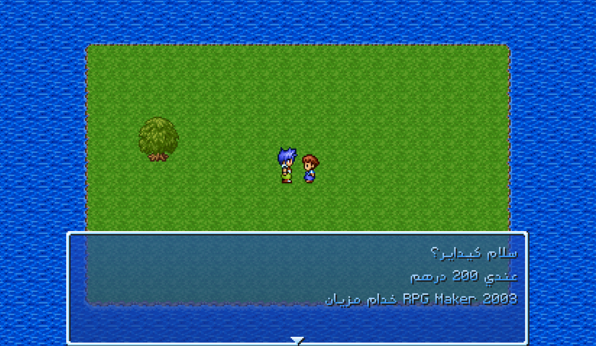

# EasyRPG-Arabic

EasyRPG-Arabic is a fork of EasyRPG Player focused on making it practical to
create RPG Maker 2000/2003 games in Arabic.

It builds on EasyRPG Player's existing HarfBuzz text shaping and adds the
Arabic-specific pieces needed around it: a bundled Arabic pixel font, ICU
Unicode BiDi for mixed Arabic/Latin/numbers, right-aligned Arabic dialogue and
choices, RTL menus and UI layouts, and true RTL dialogue typewriter rendering
— Arabic dialogue is revealed from right to left.

The project also includes tools for managing Arabic game text using LcfTrans
and gettext PO files.

## Screenshots



## Download

Get **EasyRPG-Arabic v0.2** from the
[v0.2 prerelease page](https://github.com/DyarikoMan/EasyRPG-Arabic/releases/tag/v0.2-arabic).
To prepare an Arabic RPG Maker 2003 installation, download
[EasyRPG-Arabic-Setup.exe](https://github.com/DyarikoMan/EasyRPG-Arabic/releases/download/v0.2-arabic/EasyRPG-Arabic-Setup.exe).
The public Setup requires you to provide a supported official Maniacs package;
it validates the package and does not redistribute Maniacs.

## Quick start

1. Put `Player.exe` in the game folder beside `RPG_RT.exe`.
2. Put the Arabic PO files in `Language/ar/`. A typical folder looks like:

   ```text
   Language/
   └── ar/
       ├── Meta.ini
       ├── Font/
       │   └── Font.ttf
       ├── RPG_RT.ldb.po
       └── Map0001.po
   ```

3. Run `Player.exe` from the game folder. Arabic is selected automatically when
an Arabic language pack is available.

EasyRPG-Arabic defaults project text encoding to Windows-1256 (CP1256), so
Arabic projects normally do not need `Encoding=1256` in `RPG_RT.ini`. You can
still override the encoding with `[EasyRPG] Encoding=...` in `RPG_RT.ini` or
with `--encoding ...` on the command line.

For optional widescreen rendering, run:

```powershell
Player.exe --game-resolution widescreen
```

## Arabic fonts

EasyRPG-Arabic includes a custom Arabic pixel font originally created by
**bou33ou** for a Minecraft Arabic localization/resource-pack project, then
reused and adapted for EasyRPG-Arabic. See the
[original Minecraft font project](https://modrinth.com/resourcepack/arabic-font).

The bundled font is `Language/ar/Font/Font.ttf`. You can replace it with another
TTF font that supports Arabic glyphs; the same font can be used for both RPG
Maker font slots. Arabic fonts can look very different at RPG Maker 2000/2003's
low resolution, so test your choice in-game.

## Tutorials

- [Create a new Arabic RPG Maker 2000/2003 game](docs/tutorials/create-arabic-game.md)
- [Arabic dialogue, choices, and RTL typewriter](docs/tutorials/arabic-dialogue-and-choices.md)

## Managing Arabic game text

See the [Arabic text toolkit guide](arabic/README.md) for details. Run the
updater from the repository or toolkit folder:

```powershell
.\arabic\tools\update-arabic.ps1 `
  -GamePath "C:\Games\MyRPG" `
  -LcfTransPath "C:\Tools\lcftrans.exe"
```

The toolkit creates or updates PO files for an RPG Maker project. It includes a
small starter set of system terms in Moroccan Darija; you can edit these
defaults for Modern Standard Arabic or another Arabic dialect.

## Arabic in the Maniacs editor

Install RPG Maker 2003 from Steam, then run EasyRPG-Arabic Setup. It leaves the
Steam installation untouched and creates the managed Arabic environment at
`<RPG Maker 2003>\Arabic`. Open its Maniacs editor and create a new project to
get the Arabic-ready setup automatically:

```text
Steam RPG Maker 2003 → EasyRPG-Arabic Setup → RPG Maker 2003\Arabic
  → Arabic Maniacs editor → New Project → Arabic-ready project
```

New projects use Windows-1256 (CP1256), include the EasyRPG `Player.exe` used by
the yellow Play/Test Play command, and start with a Moroccan Darija PO base
covering 143 canonical RPG Maker terms. They also include the BOU33OU Arabic
PixelSmall font at size 16 and default to 426×240. EasyRPG-Arabic provides
right-to-left layout, BiDi handling, and Arabic shaping; use the LcfTrans PO
workflow to update translations as project text changes. See the
[Arabic text toolkit guide](arabic/README.md) and
[Maniacs Arabic Editor guide](tools/maniacs-arabic-editor/README.md).

The public installer does not redistribute Maniacs: users provide a supported
official package, which Setup validates. An embedded-Maniacs build is for local
internal use only and must not be distributed publicly.

Future gameplay-changing EasyRPG features should remain opt-in per project
through `RPG_RT.ini`, with vanilla behavior as the default.

## Status and limitations

EasyRPG-Arabic v0.1 has been tested with the stock RPG Maker 2000/2003 UI.
Custom windows, event-driven interfaces, and unusual layouts may still reveal
RTL or text rendering issues. Please report problems or suggestions on the
[GitHub issue tracker](https://github.com/DyarikoMan/EasyRPG-Arabic/issues).

## Upstream project

EasyRPG-Arabic is a fork focused on Arabic support; it is not the upstream
EasyRPG Player project and does not claim ownership of upstream code. EasyRPG
Player is developed by the EasyRPG Project:

- [EasyRPG Player source](https://github.com/EasyRPG/Player)
- [EasyRPG Project website](https://easyrpg.org/)

Upstream attribution is retained in this repository.

## Building and license

- Build instructions: [docs/BUILDING.md](docs/BUILDING.md)
- License: [COPYING](COPYING)
- Authors and contributors: [docs/AUTHORS.md](docs/AUTHORS.md)

EasyRPG Player and this fork are distributed under the GPLv3, according to the
repository license. See `COPYING` for the license text and retain upstream
copyright and attribution notices.
